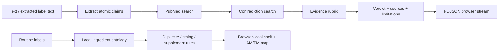

# VetoHealth

Your feed makes health promises. VetoHealth asks for the evidence.

Built for US adults aged 25–45 who encounter health advice on Reels, TikTok and product labels, VetoHealth turns checkable claims into an evidence trail and makes overlapping skincare and supplement ingredients visible.

**[Live demo — deployment URL pending](#local-setup)** · Business Cup 2.0 · Web only

## Features and implementation status

- Pure ingredient checker with 48 canonical entries, synonym matching, printed-quantity retention and explicit unknown ingredients.
- Browser-local routine shelf, product removal, synthetic demo, AM/PM map, duplicate ingredients and active classes, sourced educational cautions.
- Label OCR through a dynamically loaded Tesseract English worker. Extracted text remains editable before adding a product.
- Claim extraction preserves verbatim spans, qualifiers and compound-claim structure (`lib/extract.ts`).
- Real PubMed E-utilities search and article retrieval with throttling, retries and provider errors (`lib/pubmed.ts`).
- Shared versioned report and streaming-event contracts (`lib/types.ts`).

The claim assessor, optional Anthropic stance refinement and streaming API route are now present and have been read for this documentation. Analysis UI and history are being developed concurrently; production end-to-end behavior still requires a deployment smoke test. Pricing, scheduled alerts, accounts and billing below are product plans, not implemented features.

## Architecture



The claim pipeline is implemented in `app/api/v1/claims/analyze/route.ts`. The routine checker runs locally and does not use claim verdicts to infer ingredient safety. Next.js 16 App Router, TypeScript, Tailwind v4, React, framer-motion and lucide-react form the web app. No database or login is required.

## Five verdicts and rubric

The shared contract defines `supported`, `partially_supported`, `insufficient_evidence`, `misleading`, and `contradicted`. Labels are “Supported”, “Partly true”, “Not enough evidence”, “Misleading”, and “Contradicted”.

The rubric filters relevance below 0.5 and weighs clinical guidelines/meta-analyses at 5, systematic reviews at 4.5, randomized trials at 4, other clinical trials at 3, observational studies at 2, narrative reviews at 1.5, and case reports/other studies at 1. Animal/lab studies receive 0.5 with a further 0.3 multiplier. Conclusion cues classify support, contradiction or neutrality; optional Anthropic refinement can change stance only for supplied source IDs. Weighted support ratios, absolute claim language and missing qualifiers determine the verdict. Retrieval failure always abstains. **Current safety gap in the concurrently owned assessor:** the fewer-than-two-human-studies abstention has an exception for absolute claims with at least one relevant record. This differs from the safety skill and needs owner review before release. Scores are **evidence strength (uncalibrated)**, not a probability that a claim is true. Search results and text cues do not replace clinical appraisal.

## API contract

`POST /api/v1/claims/analyze` accepts JSON, for example:

```json
{"text":"Collagen supplements reduce wrinkles.","content_type":"text"}
```

`ContentType` permits `text`, `screenshot_text`, `transcript`, and `permitted_url_metadata`; these names do not promise direct platform scraping. The canonical response contract is the `StreamEvent` union in `lib/types.ts`. Each NDJSON line is a JSON object:

| type | fields |
| --- | --- |
| `stage` | `stage`: extract/search/contradict/assess/done; `message`; optional `claimIndex` |
| `claims` | `claims: Claim[]` |
| `claim_done` | `index`; `result: { claim, evidence, assessment }` |
| `done` | `report: Report` |
| `error` | `code`: invalid_input/rate_limited/provider_unavailable/internal; `message` |

Reports include versions, timestamps, input, claims, warnings and model metadata. Assessments expose source IDs for both evidence directions, retrieval completeness, limitations, queries and rubric version. The route truncates input to 6,000 characters, rejects fewer than eight non-whitespace characters, checks the first four extracted claims and uses a best-effort per-instance limit of 12 requests/minute/IP. Invalid input and rate limits return JSON with HTTP 400/429 before streaming. Retrieval errors produce incomplete per-claim assessments. An optional `source_url` is stored as metadata, not fetched.

## Local setup

Use Node.js 20.9+ and npm. From the repo:

```bash
npm install
npm run dev
```

Open http://localhost:3000/routine. Choose **Load demo shelf**, inspect overlaps and source links, then remove or add products. Synthetic demo labels are not real products.

Optional server environment variables in `.env.local`:

| Variable | Purpose |
| --- | --- |
| `ANTHROPIC_API_KEY` | Optional Anthropic stance/summary enhancement; rule-based checking works without it |
| `NCBI_API_KEY` | Optional NCBI key; PubMed adapter uses a shorter request interval with a key |

Never commit keys. OCR needs browser access to its worker/language assets; a failed download offers retry and manual entry.

## Verify and deploy

```bash
npx tsc --noEmit
npm test
npm run build
```

With the dev server running, verify the integrated endpoint:

```bash
curl -sN -X POST localhost:3000/api/v1/claims/analyze \
  -H 'content-type: application/json' \
  -d '{"text":"Collagen supplements reduce wrinkles. Celery juice cures eczema.","content_type":"text"}'
```

Expect `stage`, `claims`, per-claim `claim_done`, then `done`, or an honest error. A successful HTTP response alone does not establish successful evidence retrieval.

Vercel deployment:

1. Push the reviewed repository to GitHub and import it into Vercel.
2. Select the Next.js preset, use the repository root and `npm run build`.
3. Add optional server keys in project environment settings; redeploy after changes.
4. Deploy, replace the demo placeholder above, and repeat the routine and API smoke checks against production.
5. Confirm OCR assets load and server execution limits accommodate external PubMed requests.

## Spec compliance tracking

The full numbered specification is not present in this checkout. Only F-02 through F-06 and F-09 were explicitly described in the task; other IDs cannot be reliably assigned a meaning.

| Spec ID | Implementation / evidence |
| --- | --- |
| F-01 | Definition unavailable; verify against original spec |
| F-02 | Compound splitting in `extractClaims`; `tests/extract.test.ts` |
| F-03 | Questions and non-claim opinions handled by extractor; heuristic limits apply |
| F-04 | Extractor qualifier fields retain matched printed dose/concentration |
| F-05 | Retrieval failure abstention implemented; `tests/assess.test.ts` |
| F-06 | Assessor retains both source-ID directions and disagreement limitation; `tests/assess.test.ts` |
| F-07 | Definition unavailable; verify against original spec |
| F-08 | Definition unavailable; verify against original spec |
| F-09 | Routine duplicate active/class checks; `tests/ingredients.test.ts` |
| F-10 | Definition unavailable; verify against original spec |

## Limitations and safety

English label matching uses a finite dictionary and exact normalized aliases, not complete INCI interpretation. OCR can merge lines or misread text; review it. Missing quantities remain unknown. Duplicate flags do not compute daily totals or establish toxicity. AM/PM matching does not model wash-off products, formulations, frequency or individual tolerance. No-overlap results are not a safety clearance.

Routine data stays in this browser under `veto:routine`; local storage may be unavailable, cleared or accessible to others using the browser. The claim workflow sends derived search terms to PubMed and, if enabled, claim text and retrieved evidence to Anthropic. No scheduled monitoring, payment enforcement or clinical validation is claimed. Stance classification uses broad text cues rather than a validated clinical appraisal; only titles/abstracts are read. The assessor abstention exception described above remains a release concern.

Educational only: no diagnosis, prescribing, doses or medication changes. Unknown ingredients are unassessed. Ask a pharmacist, dermatologist or clinician about concerns. Source links lead to NIH ODS, NCCIH or explicitly labelled PubMed searches; search links are not individual-study citations. Provider failures must be reported as incomplete retrieval, never proof that evidence does not exist.
